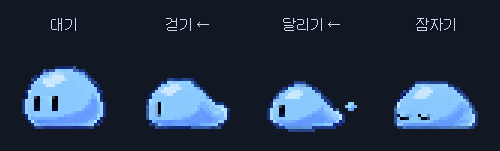
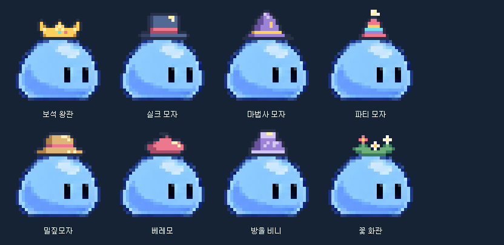

# DoT Pet · 도트펫

작업표시줄 위를 산책하고, 가끔 농담을 건네는 작은 파란 슬라임입니다. 직접 그린 캐릭터도 펫으로 사용할 수 있습니다.

## 설치와 실행

1. [최신 버전 다운로드](https://github.com/malko10/dotpet/releases/latest)에서 **DoTPet-Windows.zip**을 받으세요.
2. ZIP을 폴더에 **전부 압축 해제**하세요.
3. 폴더 안의 **DoTPet.exe**를 더블클릭하세요.

Windows 10/11에서 사용할 수 있으며 Java를 따로 설치할 필요가 없습니다. 파일을 옮길 때는 `DoTPet.exe`, `app`, `runtime`을 포함한 폴더 전체를 옮기세요. 새 버전을 실행하기 전에는 기존 펫을 종료하세요.

현재 실행 파일에는 디지털 서명이 없습니다. Windows 앱 제어 정책으로 차단되는 환경에서는 실행이 제한될 수 있습니다. 관리되는 PC라면 관리자에게 실행 가능 여부를 확인하세요.

## 펫과 놀기

| 조작 | 동작 |
| --- | --- |
| 펫 좌클릭 | 빠른 작업·키 설정·꾸미기·설정 메뉴 열기. 다시 누르면 닫기 |
| 펫 우클릭 | 걷기 켜기/끄기·공중 고정·종료 메뉴 열기. 다시 누르면 닫기 |
| 왼쪽 버튼으로 드래그 | 원하는 위치로 옮기기 |
| 드래그하다가 놓기 | 떨어뜨리기. 빠르게 던지면 포물선으로 움직입니다. |
| 말풍선 클릭 | 말풍선 바로 닫기 |

낮은 곳에서 놓으면 가볍게 착지합니다. 작업표시줄에서 **화면 높이의 절반 정도 이상** 올라갔다 떨어지면 넘어졌다가 일어납니다. 이때 가끔 머리 위에 붉은 화남 표시가 나타납니다.

펫의 농담과 잡지식 80개가 크림색 말풍선으로 가끔 나타났다 사라집니다. 메뉴를 사용하거나 펫을 끌고 있을 때, 자동화 작업 중에는 말을 멈춥니다.

말풍선을 켜 두면 실행할 때 컴퓨터 시간에 맞춰 한 번 인사합니다. 오전 5~11시는 아침, 12~17시는 오후, 18~21시는 저녁, 그 밖에는 밤 인사를 합니다. 메뉴 사용 중에는 인사를 잠시 기다립니다.

좌·우클릭 메뉴는 펫을 중심으로 부채처럼 펼쳐집니다. 메뉴가 열린 채로 펫을 다시 누르거나 메뉴 바깥을 클릭하면 부채가 접히며 닫힙니다. Esc로도 닫을 수 있습니다. 화면 가장자리에서는 안쪽으로 펼쳐지며, 닫힘 모션이 끝날 때까지 펫은 멈춥니다.

## 나만의 펫 만들기

기본 슬라임은 대기 2장·걷기 4장·달리기 6장·잠자기 2장의 애니메이션을 사용합니다. 다른 캐릭터를 사용 중이라면 **꾸미기 → 기본 슬라임 선택 → 펫에 적용 후 닫기**로 바꾸세요. 업데이트해도 사용자가 만든 캐릭터는 유지됩니다.

기본 슬라임을 선택하면 **슬라임 몸체 색상**에서 색상표나 색상 선택기로 색을 바꿀 수 있습니다. **기본 파랑**으로 원래 색으로 돌아갑니다. **펫에 적용 후 닫기**를 누르면 반영되며 다음 실행에도 유지됩니다. 눈과 명암은 유지하고 몸체 색을 바꿉니다.

**머리 장식**에서 그림을 눌러 보석 왕관·실크 모자·마법사 모자·파티 모자·밀짚모자·베레모·방울 비니·꽃 화관 중 하나를 고르세요. **장식 없음**을 누르면 벗습니다. **펫에 적용 후 닫기**로 반영하며 다음 실행에도 유지됩니다.

꾸미기와 프로그램 설정의 **크기**는 25% 단위로 조절합니다. 외형과 표시 창이 함께 커지며, 미리보기도 그림 전체를 보여줍니다. 원본 그림은 유지하고 모니터 배율에 맞춘 정수 픽셀 단위로 표시해 도트의 폭이 불규칙해지거나 흐려지는 것을 줄였습니다.

1. 펫 좌클릭 → **꾸미기**를 여세요.
2. **새로 만들기**로 빈 캐릭터를 만들고 픽셀 편집기에서 그리세요. 연필·지우개와 색상 팔레트를 사용할 수 있습니다.
3. **펫에 적용 후 닫기**를 누르면 바로 반영되고 다음 실행에도 복원됩니다. 캐릭터 선택 목록에도 따로 보관하려면 **캐릭터 저장**을 누르세요.

간단히 한 장만 그리고 싶다면 **모든 프레임에 복사**를 사용하세요. 동작별 애니메이션을 만들려면 프레임 편집을 펼쳐 대기·걷기·달리기·잠자기 그림을 편집하세요. 걷기와 달리기는 **왼쪽을 바라보는 그림만** 그리면 오른쪽 이동 때 자동으로 반전됩니다.

편집한 캐릭터는 편집용 파일로 저장하고 불러올 수 있으며, PNG로 내보낼 수도 있습니다. 꾸미기에서 펫의 크기·색상·좌우 방향도 바꿀 수 있습니다.

외부 그림을 한 장씩 넣으려면 **애니메이션 편집**을 펼쳐 동작과 프레임을 고른 다음 **이미지 가져오기**를 누르세요. PNG·JPG·BMP를 **선택한 프레임 하나에만** 넣으며 다른 프레임은 유지됩니다. 투명 PNG도 사용할 수 있고 크기가 다르면 현재 캔버스에 비율을 유지해 맞춥니다. 잘못 넣었으면 **Ctrl+Z**로 되돌리세요. **프로젝트 열기**는 저장한 `.dotpet` 파일 전체를 불러옵니다.

## 빠른 작업

펫 좌클릭 → **빠른 작업**에서 사용할 수 있습니다.

- **브라우저 주소 복사:** 버튼을 누른 뒤 준비 시간 안에 복사할 브라우저를 선택하세요.
- **파일 경로 복사:** 파일 선택 창에서 원하는 파일을 고르세요.
- **문구 복사·붙여넣기:** 자주 쓰는 문구를 등록하세요. 붙여넣기는 준비 시간 안에 대상 프로그램을 선택하세요.
- **오토 클릭:** 간격과 횟수를 지정하고 시작하세요. **무한 반복**을 체크하면 중지할 때까지 계속 클릭합니다. 시작 전 준비 시간에 마우스를 클릭할 위치로 옮기세요.

오토 클릭은 **기본 F8** 또는 **긴급 중지 버튼**으로 멈춥니다. 빠른 작업 창을 닫거나 펫을 종료해도 중지합니다. 중지 단축키를 사용할 수 없는 경우에는 클릭을 시작하지 않습니다. 저장한 설정을 불러와도 자동으로 시작하지 않습니다.

## 단축키와 마우스 제스처

펫 좌클릭 → **키 설정**에서 전역 단축키와 휠 드래그를 켜고 원하는 기능을 지정하세요. 처음에는 둘 다 꺼져 있습니다.

키 입력 칸을 클릭하고 원하는 조합을 누른 뒤 저장하세요. 휠 제스처는 휠 버튼을 누른 채 왼쪽·오른쪽·위·아래로 드래그하고 놓으면 실행됩니다.

**붙여넣기**는 현재 클립보드 내용을, **등록 문구 붙여넣기**는 빠른 작업에 저장한 문구를 붙입니다. 각 기능 아래의 **붙여넣은 뒤 Enter 누르기**를 체크하면 붙인 뒤 Enter를 한 번 누릅니다. 체크를 끄면 붙여넣기만 합니다. 같은 옵션이 그 기능에 연결한 단축키와 제스처에 적용되며 다음 실행에도 유지됩니다. 등록 문구의 체크는 빠른 작업 창에서도 바꿀 수 있습니다.

**전체 선택**은 현재 프로그램에 Ctrl+A를, **전체 선택 후 복사**는 Ctrl+A 다음 Ctrl+C를 보냅니다. 두 기능도 원하는 단축키나 휠 제스처에 직접 연결하세요. 대상 프로그램에서 해당 키 조합을 지원해야 동작합니다.

**창 전환 (Alt+Tab)**은 직전에 사용한 창으로 한 번 전환합니다. 키 설정에서 원하는 단축키나 제스처를 연결하세요.

이전 **붙여넣고 Enter** 설정은 붙여넣기 옵션으로 통합됩니다. 일반 붙여넣기와 둘 다 지정했다면 일반 단축키를 유지하고 Enter 체크는 끈 상태로 시작하므로, 키 설정에서 원하는 조합과 체크값을 확인하세요.

| 기능 | 기본 단축키 |
| --- | --- |
| 빠른 작업 열기 | Ctrl+Alt+Q |
| 브라우저 주소 복사 | Ctrl+Alt+U |
| 파일 경로 복사 | Ctrl+Alt+F |
| 등록 문구 복사 / 붙여넣기 | Ctrl+Alt+T / Ctrl+Alt+P |
| 오토 클릭 시작 / 중지 | Ctrl+Alt+F6 / F8 |
| 걷기 켜기·끄기 / 공중 고정 | Ctrl+Alt+M / Ctrl+Alt+G |

오토 클릭 실행 중에는 전역 단축키 설정을 꺼 두었어도 지정한 긴급 중지 키가 작동합니다. 일부 프로그램의 휠 자동 스크롤과 제스처가 함께 실행될 수 있습니다. 관리자 권한으로 실행 중인 프로그램에는 자동 입력이 제한될 수 있습니다.

## 저장과 알아둘 점

- 저장한 캐릭터와 입력·문구·클릭 설정은 `%APPDATA%\DoTPet`에 보관됩니다. 백업하려면 이 폴더를 복사하세요.
- 현재는 기본 모니터를 기준으로 움직입니다.
- 적용한 캐릭터·애니메이션·색상·방향·크기와 마지막 위치가 다음 실행에 복원됩니다. 모니터 배치가 바뀌어도 펫은 화면 안으로 이동합니다.
- 설정 파일이 손상되면 백업을 사용하거나 기본값으로 시작하며 기존 파일은 보존합니다.
- 문제가 있으면 [문제 제보](https://github.com/malko10/dotpet/issues)에 사용 중인 Windows 버전과 증상을 남겨 주세요.

## 프로그램 설정

펫 좌클릭 → **프로그램 설정**에서 자동 걷기·중력·수다 말풍선·다른 창 위 표시·펫 크기를 바꿀 수 있습니다. 변경 사항은 바로 적용되고 자동 저장됩니다.

**다음 실행 때 위치 기억하기**를 끄면 실행할 때 작업표시줄 위에서 시작합니다. **펫을 작업표시줄 위로 이동** 버튼으로 현재 펫을 바로 내려놓을 수도 있습니다. 설정 창의 사용자 데이터 폴더 경로를 복사해 캐릭터와 설정을 백업하세요.
