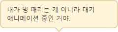

# DoT Pet · 도트펫

작업표시줄 위를 산책하고, 가끔 농담을 건네는 작은 픽셀 친구입니다. 직접 그린 캐릭터를 펫으로 사용할 수 있습니다.

## 설치와 실행

1. [최신 버전 다운로드](https://github.com/malko10/dotpet/releases/latest)에서 **DoTPet-Windows.zip**을 받으세요.
2. ZIP을 폴더에 **전부 압축 해제**하세요.
3. 폴더 안의 **DoTPet.exe**를 더블클릭하세요.

Windows 10/11에서 사용할 수 있으며 Java를 따로 설치할 필요가 없습니다. 파일을 옮길 때는 `DoTPet.exe`, `app`, `runtime`을 포함한 폴더 전체를 옮기세요. 새 버전을 실행하기 전에는 기존 펫을 종료하세요.

## 펫과 놀기

| 조작 | 동작 |
| --- | --- |
| 펫 좌클릭 | 빠른 작업·키 설정·꾸미기·설정 메뉴 열기 |
| 펫 우클릭 | 걷기 켜기/끄기·공중 고정·종료 |
| 왼쪽 버튼으로 드래그 | 원하는 위치로 옮기기 |
| 드래그하다가 놓기 | 떨어뜨리기. 빠르게 던지면 포물선으로 움직입니다. |
| 말풍선 클릭 | 말풍선 바로 닫기 |

낮은 곳에서 놓으면 가볍게 착지합니다. 작업표시줄에서 **화면 높이의 절반 정도 이상** 올라갔다 떨어지면 넘어졌다가 일어납니다. 이때 가끔 머리 위에 붉은 화남 표시가 나타납니다.

펫의 농담과 잡지식은 크림색 말풍선으로 잠깐 나타났다 사라집니다. 메뉴를 사용하거나 펫을 끌고 있을 때, 자동화 작업 중에는 말을 멈춥니다.

## 나만의 펫 만들기

1. 펫 좌클릭 → **꾸미기**를 여세요.
2. **새로 만들기**로 빈 캐릭터를 만들고 픽셀 편집기에서 그리세요. 연필·지우개와 색상 팔레트를 사용할 수 있습니다.
3. **펫에 적용 후 닫기**를 누르면 데스크톱 펫에 반영됩니다. 계속 보관하려면 저장도 해 주세요.

간단히 한 장만 그리고 싶다면 **모든 프레임에 복사**를 사용하세요. 동작별 애니메이션을 만들려면 프레임 편집을 펼쳐 대기·걷기·달리기·잠자기 그림을 편집하세요. 걷기와 달리기는 **왼쪽을 바라보는 그림만** 그리면 오른쪽 이동 때 자동으로 반전됩니다.

편집한 캐릭터는 편집용 파일로 저장하고 불러올 수 있으며, PNG로 내보낼 수도 있습니다. 꾸미기에서 펫의 크기·색상·좌우 방향도 바꿀 수 있습니다.

## 빠른 작업

펫 좌클릭 → **빠른 작업**에서 사용할 수 있습니다.

- **브라우저 주소 복사:** 버튼을 누른 뒤 준비 시간 안에 복사할 브라우저를 선택하세요.
- **파일 경로 복사:** 파일 선택 창에서 원하는 파일을 고르세요.
- **문구 복사·붙여넣기:** 자주 쓰는 문구를 등록하세요. 붙여넣기는 준비 시간 안에 대상 프로그램을 선택하세요.
- **오토 클릭:** 간격과 횟수를 지정하고 시작하세요. **무한 반복**을 체크하면 중지할 때까지 계속 클릭합니다. 시작 전 준비 시간에 마우스를 클릭할 위치로 옮기세요.

오토 클릭은 **기본 F8** 또는 **긴급 중지 버튼**으로 멈춥니다. 빠른 작업 창을 닫거나 펫을 종료해도 중지합니다. 중지 단축키를 사용할 수 없는 경우에는 클릭을 시작하지 않습니다. 저장한 설정을 불러와도 자동으로 시작하지 않습니다.

## 단축키와 마우스 제스처

펫 좌클릭 → **키 설정**에서 전역 단축키와 휠 드래그를 켜고 원하는 기능을 지정하세요. 처음에는 둘 다 꺼져 있습니다.

키 입력 칸을 클릭하고 원하는 조합을 누른 뒤 저장하세요. 휠 제스처는 휠 버튼을 누른 채 왼쪽·오른쪽·위·아래로 드래그하고 놓으면 실행됩니다.

| 기능 | 기본 단축키 |
| --- | --- |
| 빠른 작업 열기 | Ctrl+Alt+Q |
| 브라우저 주소 복사 | Ctrl+Alt+U |
| 파일 경로 복사 | Ctrl+Alt+F |
| 등록 문구 복사 / 붙여넣기 | Ctrl+Alt+T / Ctrl+Alt+P |
| 오토 클릭 시작 / 중지 | Ctrl+Alt+F6 / F8 |
| 걷기 켜기·끄기 / 공중 고정 | Ctrl+Alt+M / Ctrl+Alt+G |

오토 클릭 실행 중에는 전역 단축키 설정을 꺼 두었어도 지정한 긴급 중지 키가 작동합니다. 일부 프로그램의 휠 자동 스크롤과 제스처가 함께 실행될 수 있습니다. 관리자 권한으로 실행 중인 프로그램에는 자동 입력이 제한될 수 있습니다.

## 저장과 알아둘 점

- 저장한 캐릭터와 입력·문구·클릭 설정은 `%APPDATA%\DoTPet`에 보관됩니다. 백업하려면 이 폴더를 복사하세요.
- 현재는 기본 모니터를 기준으로 움직입니다.
- 프로그램 설정 메뉴와 종료 후 펫 위치·선택 자동 복원은 아직 지원하지 않습니다.
- 문제가 있으면 [문제 제보](https://github.com/malko10/dotpet/issues)에 사용 중인 Windows 버전과 증상을 남겨 주세요.
